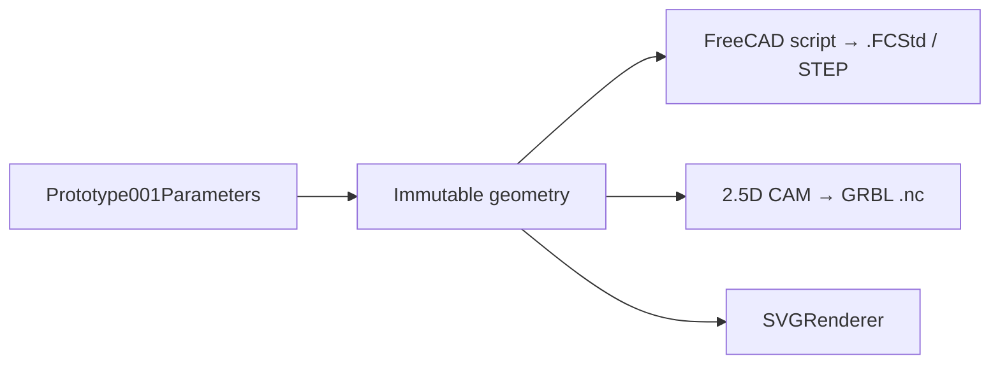

# CNCguitarwizard

**Try it in your browser, no install needed:
[jounilappi.hopto.org/CNCguitarwizard](https://jounilappi.hopto.org/CNCguitarwizard/)** —
set the parameters, build, preview the toolpaths and download the G-code and
FreeCAD script without cloning this repository.

CNCguitarwizard is an open-source Python foundation for designing guitar
necks, fretboards, bodies, and CNC-ready geometry. The current release
provides immutable geometry, fret and fretboard calculations, a fluent neck
builder, dependency-free SVG rendering, a FreeCAD backend that builds the
complete Prototype001 neck, fretboard, headstock and body as `.FCStd` and
STEP files, and a dependency-free CAM planner that writes GRBL G-code for the body
(2.5D), the neck (3D roughing and ball-nose finishing) and the fretboard.

## Getting started

You need Python 3.12 or newer. FreeCAD (1.0+) is optional: without it you
still get the FreeCAD scripts and all of the G-code, just not the `.FCStd`
and STEP models.

```bash
git clone <this repository>
cd CNCguitarwizard
python3 -m venv .venv
source .venv/bin/activate        # Windows: .venv\Scripts\activate
python -m pip install -e .
```

Build Prototype001 — the complete right-handed guitar (or, with
`handedness = "left"`, its left-handed mirror image): neck, fretboard,
headstock and body — with one command:

```bash
python -m cncguitarwizard build-prototype001 --output build
```

The build locates `freecadcmd` on its own (including the standard macOS
`/Applications/FreeCAD.app` location); point it elsewhere with
`--freecad-command /path/to/freecadcmd` or the `FREECAD_CMD` environment
variable, or skip FreeCAD entirely with `--scripts-only`.

To build your own design, save it in the web app (*Save design*) and pass
the JSON file with `--design`; the FCStd and STEP models, which the
browser cannot make, then come out of the local build with everything
else:

```bash
python -m cncguitarwizard build-prototype001 --design my_guitar.json --output build/my_guitar
```

The finished model goes into other common 3D formats on its own, without
building it again: STEP for each part on its own (the build's
`Prototype001.step` holds them all), STL, 3MF and OBJ (meshes within 0.05 mm of the
surface, for 3D printing, slicers, CAM and Blender), GLB (glTF, for 3D
viewers on the web and phones, in colour), IGES and BREP (exact surfaces,
for other CAD and CAM). Each part is a file of its own
(`Prototype001_Body.stl`), and the whole guitar one more
(`Prototype001.stl`); `--format` again for more formats, `all` for every
one:

```bash
python -m cncguitarwizard export-prototype001 --output build/my_guitar --format stl --format glb
```

The web app makes them itself, in the browser, as files (all but IGES): it
runs the build's FreeCAD script on OpenCascade compiled for the web
([The 3D formats made in the browser](docs/backends/occt.md)), the same
model FreeCAD makes, with no FreeCAD at all.

Everything lands in the `build/` directory (git-ignored):

| File | What it is |
| --- | --- |
| `Prototype001.FCStd` | Editable FreeCAD document: neck, fretboard and body as separate solids, and the parameter sheet as its `Parameters` spreadsheet |
| `Prototype001.step` | The same three solids for any other CAD/CAM tool |
| `Prototype001.FCMacro`, `Prototype001_freecad.py` | The generated FreeCAD script (macro and plain-Python form) |
| `Body_*.nc` | GRBL G-code for the body (index pins, top, back) — see [Body G-code](docs/cam/01_body_gcode.md) |
| `Neck_*.nc`, `Fretboard_*.nc` | GRBL G-code for the neck (five programs, flat + ball nose) and the fretboard (five programs, four tools) — see [Neck and fretboard G-code](docs/cam/02_neck_and_fretboard_gcode.md) |
| `*.svg` next to each `.nc` | Toolpath plots of those programs |
| `Prototype001_plan.dxf`, `Prototype001_covers.dxf` | The plan outlines (a layer a kind) and the sheet plates laid out for cutting, R12 DXF for other CAD, CAM and laser programs — see [DXF](docs/render/02_dxf.md) |
| `build.json` | Every parameter used, stock size, per-program time estimates, checksums, the parameter sheet |
| `Prototype001_parameters.csv` | The parameter sheet: key dimensions with units and sources, values derived from the geometry, fret checks and a review status — see [Parameter sheet](docs/workflows/parameter_sheet.md) |
| `Prototype001_check.py`, `freecad_check.log` | The finished model measured in FreeCAD and checked against the parameter sheet: its parts valid, the STEP matching it, the body's size; the result is `model_check` in `build.json` — see [Model check](docs/workflows/parameter_sheet.md#model-check) |
| `freecad.log` | FreeCAD's own output from the run |

Each program's file is named for it and the tool it is cut with, e.g.
`Body_top_6mm_flathead.nc`, `Neck_back_finish_6mm_ballnose.nc`.

To change a dimension, edit the defaults in
`src/cncguitarwizard/presets/prototype001.py` (every value is a documented
field of `Prototype001Parameters`) or build from Python with overrides:

```python
from dataclasses import replace
from pathlib import Path

from cncguitarwizard.presets import Prototype001Parameters
from cncguitarwizard.workflows import build_prototype001

parameters = replace(Prototype001Parameters(), body_thickness=42.0)
build_prototype001(Path("build"), parameters)
```

Tool, feed and fixturing settings for the G-code live in
`cncguitarwizard.cam.MachiningParameters` and can be passed the same way
(`build_prototype001(..., machining=MachiningParameters(feed_rate=800.0))`).

## From the command line, or with Claude

Four commands describe, start, change and check a design file, the same
one the web app saves and opens, so a design can be made without the
browser, or by an AI assistant:

```bash
python -m cncguitarwizard new-design --instrument electric_guitar --style telecaster --name "My Tele" --output my_tele.json
python -m cncguitarwizard settings --design my_tele.json --search "neck pickup"
python -m cncguitarwizard set --design my_tele.json handedness=left scale_length=25.5in
python -m cncguitarwizard check --design my_tele.json
```

Every change is read and checked as the web app reads and checks it, and
a change that breaks the design is not saved. The
[CNCguitarwizard skill](skills/cncguitarwizard/SKILL.md) teaches Claude
to design with them from a description in plain words: copy
`skills/cncguitarwizard` into `~/.claude/skills/` for Claude Code. See
[Designing from the command line, or with Claude](docs/workflows/design_commands.md).

## In the browser

The same package runs client-side on GitHub Pages: `site/` loads it into
Pyodide, draws a form from the parameter dataclasses, and builds the
FreeCAD script, body G-code, toolpath plots and report in the browser —
no installation needed. Only the `.FCStd`/STEP step still needs a local
FreeCAD. **Save design** and **Load design** keep your settings and your
drawn body and headstock in a JSON file on your own computer; that file
builds locally, FCStd and STEP included, with
`build-prototype001 --design` (see above). **Undo** and **Redo**
(Ctrl/Cmd+Z, Ctrl/Cmd+Shift+Z) step back and forward through your
changes in the editors and the form. See [Web app](docs/site.md) for
local preview and deployment.

## Architecture



## Python API quick start

```python
from cncguitarwizard.builder import NeckBuilder
from cncguitarwizard.render.svg import SVGRenderer

neck = (
    NeckBuilder()
    .scale_length(609.6)
    .nut_width(42.0)
    .bridge_width(63.0)
    .build()
)

svg = SVGRenderer().render(neck.fretboard)
```

## Documentation

- [Public package reference](docs/reference/01_public_packages.md)
- [Geometry](docs/geometry/01_primitives.md)
- [Fretboard](docs/geometry/02_fretboard.md)
- [Solid body](docs/geometry/12_body.md)
- [Neck builder](docs/builder/01_neck_builder.md)
- [Prototype001 preset](docs/presets/prototype001.md)
- [Building Prototype001 in FreeCAD](docs/workflows/prototype001.md)
- [Parameter sheet](docs/workflows/parameter_sheet.md)
- [Designing from the command line, or with Claude](docs/workflows/design_commands.md)
- [FreeCAD backend](docs/backends/freecad.md)
- [Body G-code](docs/cam/01_body_gcode.md)
- [Neck and fretboard G-code](docs/cam/02_neck_and_fretboard_gcode.md)
- [Web app on GitHub Pages](docs/site.md)
- [SVG rendering](docs/render/01_svg.md)
- [Architecture](ARCHITECTURE)
- [Roadmap](ROADMAP)

## Development

Install the development extras on top of the setup above, then run the
full quality gate before completing a change:

```bash
python -m pip install -e ".[dev]"
```

```bash
python -m pytest
ruff check .
mypy
```

GitHub Actions runs the same pytest, Ruff, and mypy checks on every push and
pull request. Python warnings fail the test step.
